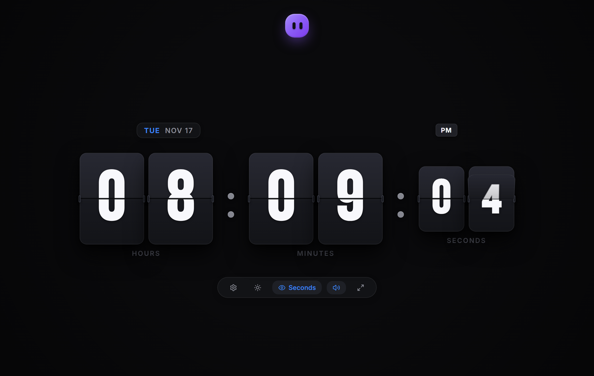
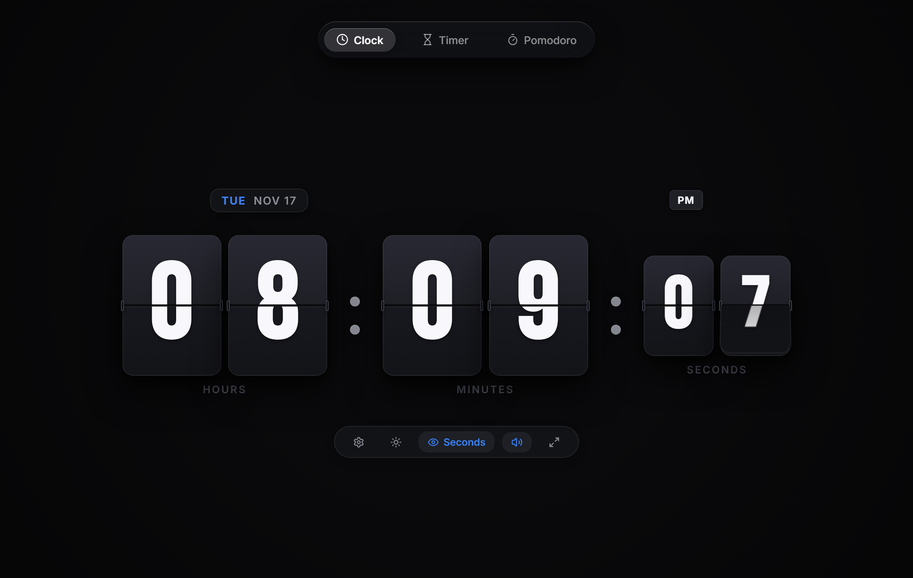
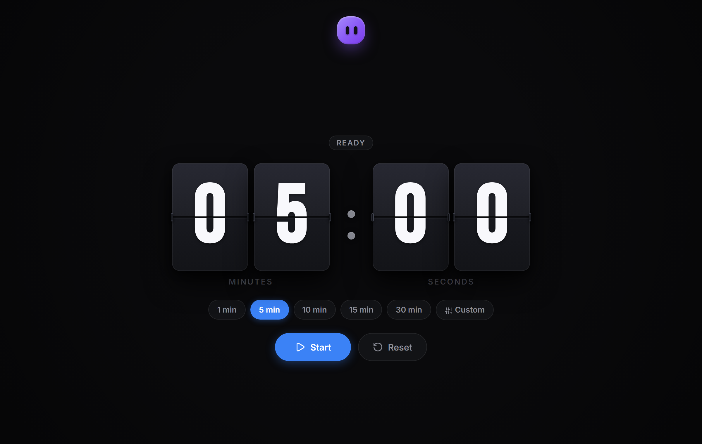
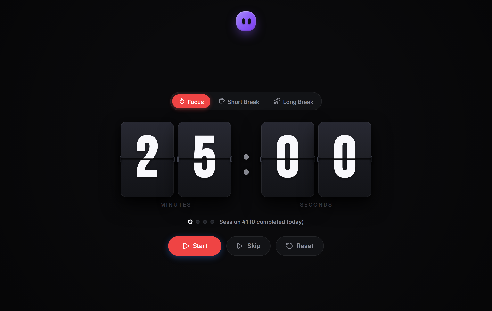
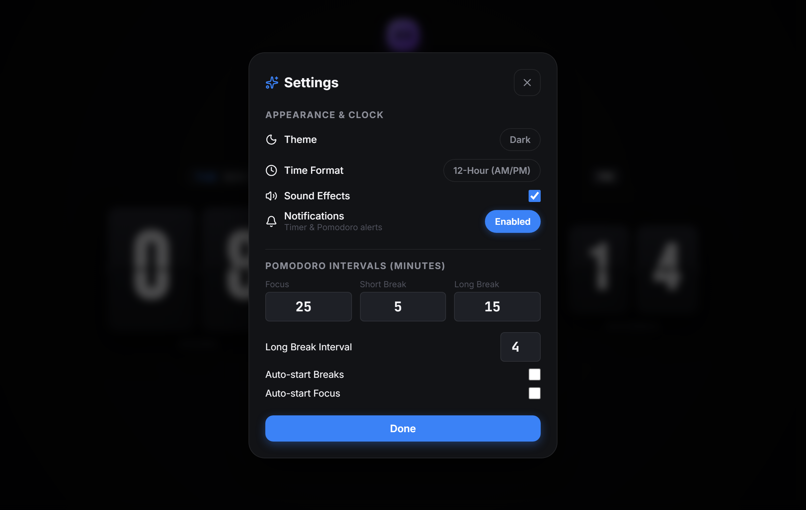

<p align="center">
  
</p>

<h1 align="center">My Clock</h1>

<p align="center">
  A minimal, lightweight, cross-platform personal productivity application for <b>Windows</b> and <b>Android</b>, built with <b>React</b>, <b>TypeScript</b>, <b>Vite</b>, and <b>Tauri 2</b>.
</p>

---

## 📸 Application Showcase

### 1. 🕰️ Retro Flip Clock (Main View)
Features authentic split-flap 3D physics, real-time synthesized mechanical flap sounds, date badges, AM/PM indicators, and a floating interactive Dynamic Island.



---

### 2. 🏝️ Apple-Style Dynamic Island (Fluid Glassmorphic Navigation)
The navigation bar behaves like an Apple Dynamic Island:
- **Contracted:** A cute squircle mascot whose eyes smoothly follow your cursor across the screen with natural blinking.
- **Expanded (on hover):** Smoothly expands with fluid spring physics (`cubic-bezier(0.16, 1, 0.3, 1)`) into a borderless frosted glass pill.



---

### 3. ⏳ Countdown Timer
Set custom durations or use quick presets (1m, 5m, 10m, 15m, 30m). Includes timestamp-based accuracy resilient to app suspension and minimization, melodic completion chimes, and system notifications.



---

### 4. 🍅 Pomodoro Focus Timer
Structured sessions for **Focus** (25 min default), **Short Break** (5 min default), and **Long Break** (15 min default), with interval tracking dots and session statistics.



---

### 5. ⚙️ Settings & Customization
Fine-tune clock format (12h / 24h), dark & light themes, sound effects, system notifications, and Pomodoro session intervals.



---

## ⚡ Core Features

- **Retro Split-Flap Animation:** Physically synchronized 3D folding and unfolding leaves with dynamic shadow overlays and hinge pins.
- **Interactive Cursor-Tracking Mascot:** The Dynamic Island avatar smoothly watches your mouse cursor in real-time.
- **Zero-Latency Audio:** Mechanical flap clicks and multi-tone alarm chimes synthesized via the Web Audio API without requiring external audio files.
- **Timestamp-Accurate Timing:** Timers calculate elapsed time via epoch timestamps (`Date.now()`), preventing drift when the app is minimized, screen is off, or the device sleeps.
- **Cross-Platform:** Single codebase running natively on Windows desktop and Android mobile via Tauri 2.
- **100% Private & Offline:** Zero tracking, accounts, ads, or network dependencies.

---

## 🛠️ Tech Stack

- **Frontend:** React 18 + TypeScript + Vite
- **Cross-Platform Runtime:** Tauri 2 (Desktop & Mobile)
- **Styling & Physics:** CSS 3D Transforms (`rotateX`, `perspective`, `transform-origin`) with Apple spring easing
- **Icons:** Lucide React
- **Sound:** Synthesized Web Audio API (offline, zero-latency)
- **Notifications:** Cross-platform notification service integrating Tauri 2 Plugin Notification with Web Notification API fallback

---

## 📁 Project Structure

```
flipclock/
├── docs/
│   └── images/                 # High-resolution application screenshots
├── index.html
├── package.json
├── vite.config.ts
├── tsconfig.json
├── src/
│   ├── app/
│   │   ├── App.tsx             # Main orchestrator & layout
│   │   ├── AppHeader.tsx       # Header utilities
│   │   └── AppNavigation.tsx   # Dynamic Island with cursor-tracking eyes
│   ├── components/
│   │   └── flip/
│   │       ├── FlipCard.tsx    # 3D split-flap card with top/bottom leaves
│   │       ├── FlipUnit.tsx    # Paired 2-digit unit (e.g. HH, MM, SS)
│   │       └── FlipSeparator.tsx # Colon indicator dots
│   ├── features/
│   │   ├── clock/
│   │   │   └── FlipClock.tsx   # Flip Clock view, controls & date badge
│   │   ├── timer/
│   │   │   └── CountdownTimer.tsx # Timer view, presets & custom picker
│   │   └── pomodoro/
│   │       └── PomodoroTimer.tsx  # Pomodoro view, cycle indicator & actions
│   ├── hooks/
│   │   ├── useClock.ts         # Clock drift compensation & format logic
│   │   ├── useTimer.ts         # Timestamp-based countdown & background sync
│   │   ├── usePomodoro.ts      # Pomodoro cycle state machine
│   │   ├── useTheme.ts         # Dark/Light theme management
│   │   └── useFullscreen.ts    # Cross-platform fullscreen handler
│   ├── services/
│   │   ├── audioService.ts     # Synthesized mechanical flip & chime sounds
│   │   ├── notificationService.ts # Tauri 2 & Web Notification bridge
│   │   └── storageService.ts   # Safe typed localStorage persistence
│   ├── settings/
│   │   ├── SettingsModal.tsx   # Configuration modal
│   │   └── types.ts            # Type definitions & defaults
│   └── styles/
│       ├── variables.css       # CSS design tokens & themes
│       ├── global.css          # Base typography & layout
│       ├── flipcard.css        # 3D transform keyframes & flap mechanics
│       ├── dynamicIsland.css   # Apple-style spring physics & glassmorphism
│       ├── clock.css           # Clock styling
│       ├── timer.css           # Timer styling
│       └── pomodoro.css        # Pomodoro styling
└── src-tauri/
    ├── Cargo.toml              # Tauri 2 dependencies & plugins
    ├── tauri.conf.json         # Window configuration & permissions
    ├── capabilities/
    │   └── default.json        # Tauri 2 security capabilities
    ├── build.rs
    ├── icons/                  # Multi-resolution app icons
    └── src/
        ├── lib.rs              # Mobile & desktop entry point
        └── main.rs             # Windows subsystem bootstrap
```

---

## 🚀 Getting Started

### 1. Web Development Server
To run the web version locally in your browser:
```bash
npm run dev
```
Open `http://localhost:5173` in your browser.

### 2. Build Web Assets
```bash
npm run build
```

### 3. Desktop Application (Windows)
```bash
# Run in development mode with hot-reload
npm run tauri dev

# Build production executable / installer
npm run tauri build
```

### 4. Android Build
```bash
# Initialize Android project
npm run tauri android init

# Run on connected Android device or emulator
npm run tauri android dev

# Generate release APK / AAB
npm run tauri android build
```
